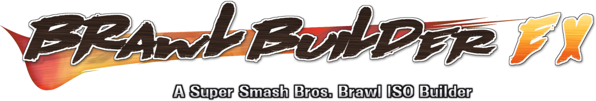

The Ultimate Super Smash Bros Brawl ISO Builder

## About
This is a tool to build modded SSBB ISOs. It currently works with many Brawl mods, although there are some issues. All versions of Project M should run fine, including 3.6 and above, with full support for sfx .sawnd files and alternate stages. Most Project M mods should work as well. Psycho Ghost's 3.6 build has been tested and seems to work fine. Legacy M, however, does not work at this time (with a regular build; Legacy MX works as an EX build).

BrawlBuilderEx is a fork of [mogzol/BrawlBuilder](https://github.com/mogzol/BrawlBuilder) that adds EX builds: launcher-based mods (the Project+ family: Project+, P+Ex / PMEX Remix, Legacy MX, Brawl Minus, Brawl Void, ...) become a self-contained disc image with no SD card, no launcher app and no cheat file. Pick the mod's download folder (or its SD folder, its `pf` folder, or a folder with an `sd.raw`) as the mod folder, and BrawlBuilderEx detects the launcher-based mod and offers the EX build. Everything else (ISO/WBFS input, custom ID and title, banner, removing Subspace) works as before. Nothing in EX is specific to one mod; see [How EX works](#how-ex-works) below.

Other Brawl mods may or may not work, they are widely untested. It seems like anything using BrawlEx, however, does not work at this time, so all Brawl- versions beyond 2.x.6 will not work. (EX builds do handle BrawlEx: P+Ex Remix, Legacy MX and Void are BrawlEx mods.)

Hopefully compatibility will be improved in the future.

If you want to discuss BrawlBuilder, or if you have any issues, check out the official BrawlBuilder thread over on Smashboards: http://smashboards.com/threads/432675

## Downloads
BrawlBuilder can be downloaded from the releases page: https://github.com/mogzol/BrawlBuilder/releases

Just grab the latest zip, extract it, and then run BrawlBuilder.exe. The app should launch and you should be good to go.

BrawlBuilderEx targets .NET 6 (`dotnet build -c Release`, then run `bin/Release/net6.0-windows/BrawlBuilder.exe`).

## Command line arguments
`--show-wit`
This will show the wit command line windows rather than hiding them and displaying the progress in the UI.

`--show-wit-debug`
This will do the same thing as `--show-wit`, but it will keep the wit windows open once wit closes, allowing you to read the output and figure out what is going wrong.

`--no-gct-patch`
This will disable patching of the GCT based on the CodePatches.txt file in the Resources folder. Use of this option is not recommended.

`--notify-gct-patch`
This will notify you of how many GCT patches were applied from the CodePatches.txt file.

`--no-alt-pad`
This will disable alternate stage padding. Alternate stages are padded to the size of their largest alt. Disabling this will cause any alternate stage that has a file size greater than its non-alt version to stop working.

`--offset=X`
This will change the offset that the GCT is applied at (by default 80570000) to whatever X is. Setting this to 80568000 will allow Legacy M to progress a bit further than it normally does before crashing. If your mod isn't working check its gameconfig.txt for the codeliststart line, and try using the offset listed there. Note that Resources/patch/PatchCommon.xml also patches some stuff to 8057 and 0000, I don't know if thats related, but you could try editing that to match your codeliststart as well and see if it helps. (EX builds read codeliststart themselves.)

`--ex --iso <Brawl USA Rev 2 .iso/.wbfs> --mod <mod folder or sd.raw> --out <file.wbfs> [--id RSBExx] [--name "Title"] [--fit] [--remove-sse]`
Builds a launcher-based mod without the UI. `--tree <dir>` patches an already extracted game instead of `--iso`. `--fit` allows shortening movies, removing Subspace and replacing trophy models when the image would not fit a dual-layer disc (the UI asks instead). Diagnostic options: `--no-bake`, `--mem1-index`, `--keep-shadowed`, `--no-free`.

## How EX works
- **The SD card is on the disc.** The mod's SD folder (e.g. `/Minusery`, `/Project+`, `/ex_remix`, `/P+Ex`) goes onto the disc unchanged, packed into a few big files (`ex0.pak`, ...) with a hash index, and Brawl's own SD file functions (`FAFopen/FAFread/FAFseek/FAFclose/FAFstat` and the prfile2 functions under them) are redirected to it. Every SD reader of these mods (File Patch Code, sound-bank and music streamers, movie player, Syringe plugins, BrawlEx configs, CSS roster, stage/tracklist loaders) keeps working without being touched.
- **The launcher's job is done at build time.** The code handler is taken from the mod's own launcher, the code list goes to the address the launcher used (`codeliststart` in `gc.txt` / `gameconfig.txt`: lists built with GCTRealMate `-b` point into themselves), the handler is hooked like the launcher does (VBI), and the launcher's pre-pass is reproduced statically: unconditional RAM writes and C2 hooks are baked into `main.dol`, the CRT `.bss` clear spares the code list, and Brawl's "SD mounted" flag is set. EX's own helper code goes where none of the mod's codes reads or writes.
- **Memory layout.** MEM1 stays exactly vanilla: the pack's hash index (4 bytes a file) and EX's working memory go at the top of the MEM2 arena. Pointers into the vanilla FST's name table get their own copy of the string. (Only if the FST outgrew the vanilla one would the index go under it in MEM1, with heaps the mod hard-codes there moved down.)
- **Disc space.** Vanilla files that the mod replaces at the same path are never read, so they are emptied (FST entries kept). Subspace is kept unless "Remove Subspace" is checked or the image would not fit a dual-layer disc; in that case BrawlBuilderEx lists what has to go (vanilla movies shortened to 10-frame clips, then Subspace, then trophy models replaced by one small model) and asks before building.

## Notes
- BrawlBuilder attempts to patch any GCT files you give to it in order to fix numerous problems caused by loading files from disc instead of SD. The original GCT won't be modified, patches are applied to a temporary copy of it. GCT files are patched based on the CodePatches.txt file in the Resources folder. That file currently contains patches allowing for alternate stage compatibility, replacement soundbank engine compatibility, and P:M 3.6 support in general. Feel free to modify the CodePatches file with your own patches, there is a brief description of how to use it in the comments at the top of the file. EX builds don't use CodePatches.txt: the mod's codes run unmodified.

- If you are experiencing issues when playing the output ISO, make sure that you either don't have an SD card inserted, or your SD card doesn't have any mod files on it, as most mods (depending on the GCT patches that get applied) will still try to load from SD before loading from disc. In Dolphin, to eject the SD card just go in to the 'Config' menu, then go to the 'Wii' tab and untick 'Insert SD Card'.

- If you are building this from source, make sure the Resources folder from the base directory is getting copied into the same directory as the exe file, or else nothing will work. This should happen automatically on build, but if it doesn't, just copy it manually.

## Credits
- First of all, thanks to Wiimm for his amazing wit tool, which is used to extract, patch, and build the game images.
- Secondly, thanks to the Dolphin team for the awesome debug mode of Dolphin, I wouldn't have been able to get alternate stages and the replacement soundbank engine working without that.
- The folder select dialog uses Ookii dialogs, a great little library for nice looking dialogs.
- Detailed wit error messages make use of FlexibleMessageBox by JReichert
- And thanks to the creators of all the ISO builder scripts for Project M and the like, they are what I initially based this off of.
- BrawlBuilderEx: the EX build is by humboldt123 with Claude. It relies on the mods' own launchers and code lists, and on the work of the Project+, P+Ex, Legacy, Minus and Void teams.
